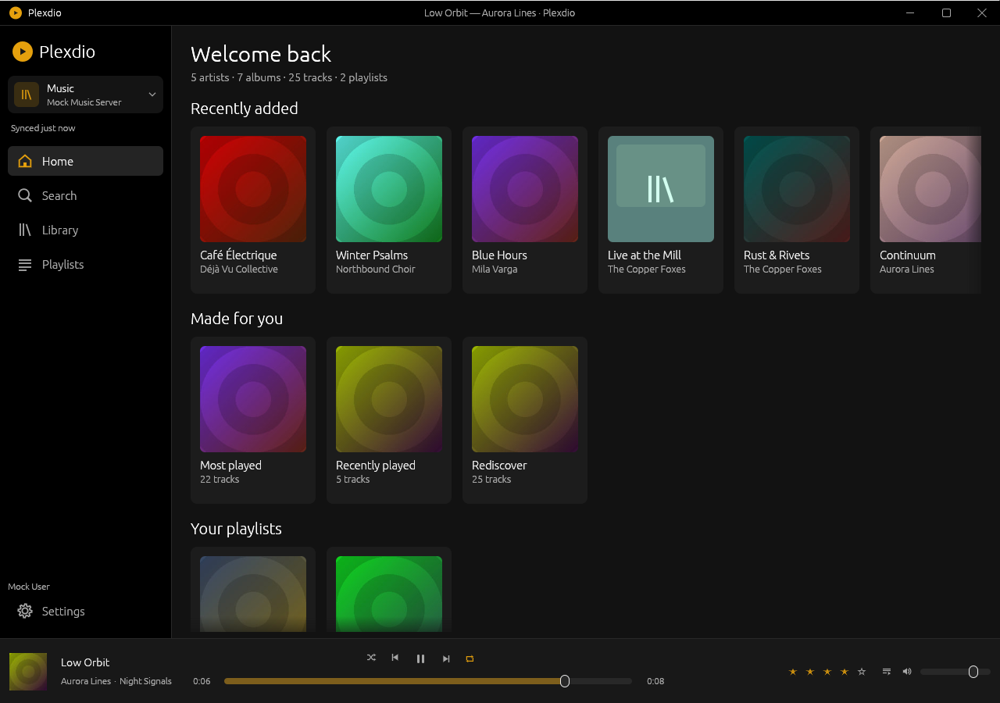
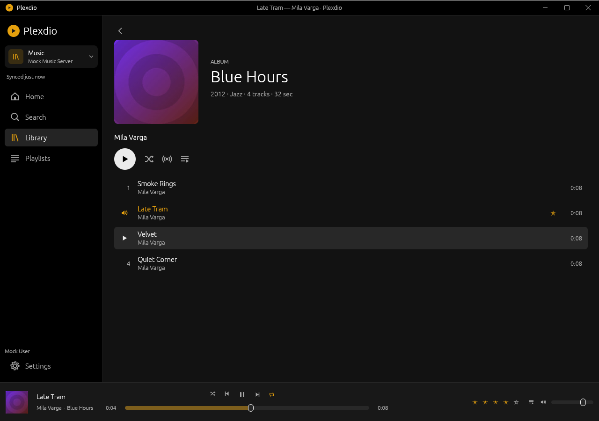
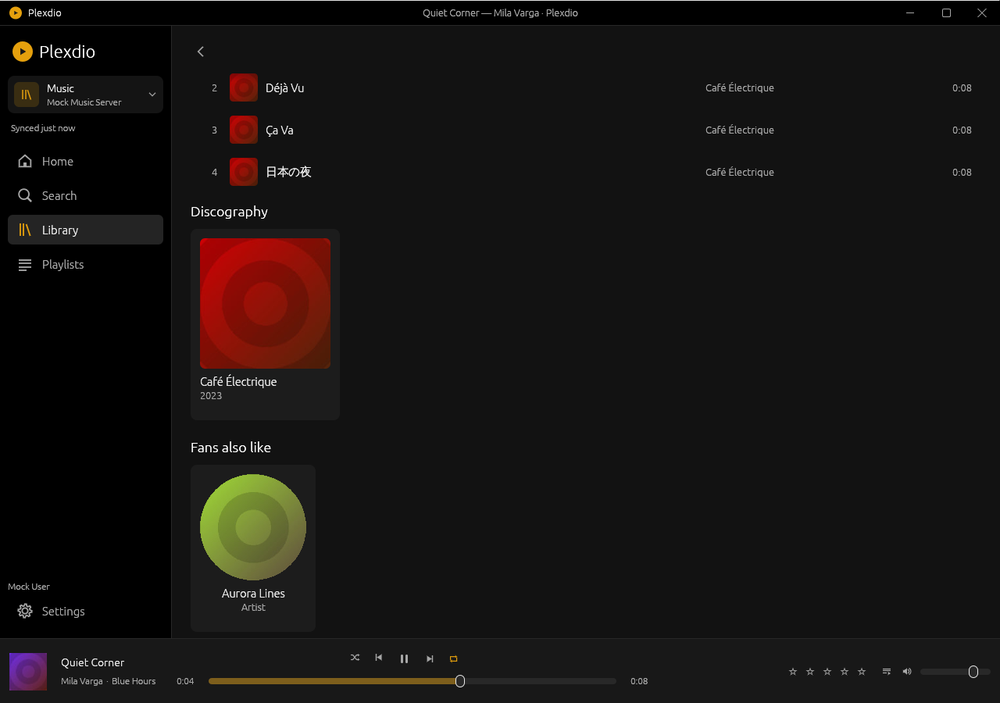
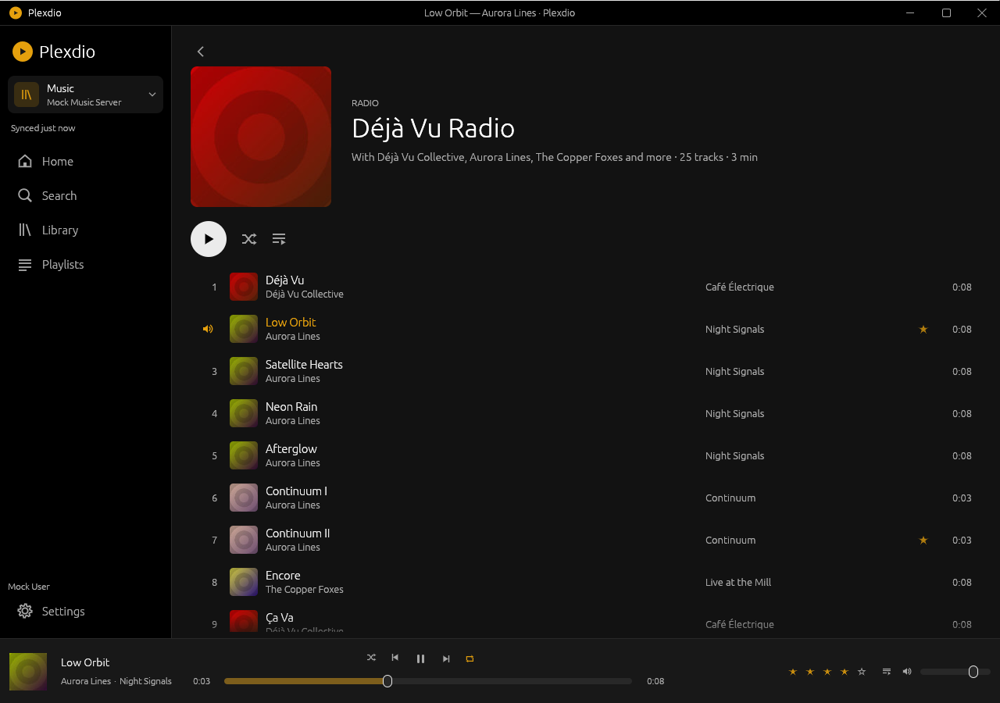
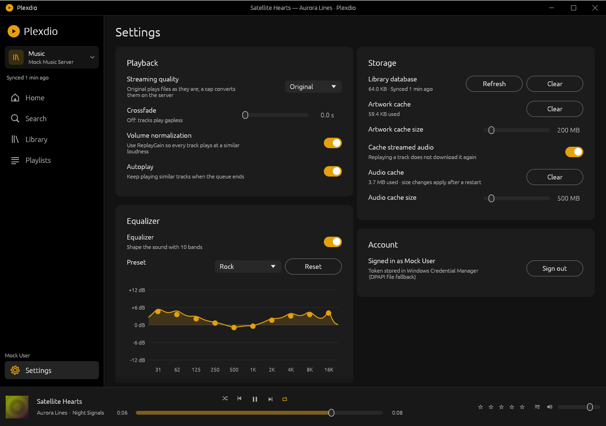

# Plexdio

A small, native Windows 10/11 x64 music player for Plex — a lean alternative to Plexamp.
One self-contained exe (9.5 MB), no installer, no runtime, no Electron.

*Formerly **Plexify**, then briefly **PlexDio**. Settings, the library cache, the saved sign-in and the start-with-Windows
entry carry over automatically on first start — see [Upgrading from Plexify](#upgrading-from-plexify).*



| Album | Artist |
|---|---|
|  |  |
| **Radio** | **Settings** |
|  |  |

Mini-player:


## What it does

- **Sign in** with the Plex PIN flow: the code is shown in the app, the browser opens the
  plex.tv page, and the token is stored in the Windows Credential Manager (DPAPI-encrypted
  file as a fallback).
- **Pick a server and library**: every connection of a server is raced and ranked
  (local > remote > relay), dead connections are skipped, the choice is remembered. The
  sidebar shows the open library and server and switches between them.
- **Offline-first library**: a per-server SQLite cache with a full and a delta sync
  (`updatedAt>>=`/`addedAt>>=` plus a count-check sweep). The UI opens the cached library
  immediately, even with the server unreachable.
- **Browsing**: Home (recently added, mixes, playlists), Artists / Albums / Tracks / Genres,
  playlists, artist/album/playlist pages, virtualised lists that stay smooth with
  100 000 tracks. Artist pages scroll as one page: Popular, Discography and **Fans also
  like** (similar artists from the server's related hubs, or genre matches from your
  library).
- **Instant search**: in-memory, diacritic-folding prefix/substring search over artists,
  albums and tracks, plus a server `/hubs/search` supplement. `Ctrl+F`.
- **Playback**: gapless and crossfade (0–12 s), ReplayGain/loudness normalisation, a
  **10-band equaliser** with presets, seek, volume, mute, prefetch and an on-disk audio
  cache. Codecs are decoded in-process with Symphonia (MP3, FLAC, AAC/M4A, ALAC, Vorbis,
  WAV); anything else — and Opus — goes through the server's universal transcoder. A dropped
  connection mid-song reconnects and resumes the download where it stopped (HTTP `Range`).
- **Now-playing bar**: Spotify-style three columns that fit any window width. Click the
  cover, title or album to open the album, the artist to open the artist. In track lists, a
  single click on the hover play icon plays the song (double-click a row still works).
- **Queue**: add next / add to queue, drag reorder, remove, clear, shuffle (weighted by rating
  and play count, artist-spread) and repeat off/all/one. The queue, track and position
  resume on the next start.
- **Radio and autoplay**: start a station from a track, artist or album; it opens on its own
  **Radio page** listing the station's tracks ("With A, B, C and more"). Sources: sonic
  `nearest` when the server offers it, else same artist/genre from the cache. When the queue
  runs out, autoplay picks up from the last track.
- **Reporting**: `/:/timeline` while playing (every 10 s and on state changes), `/:/scrobble`
  at 90 %, and star ratings through `/:/rate`.
- **Discord Rich Presence** (optional): your Discord status shows "Listening to Plexdio" with
  the song, artist, album and a progress bar while music plays; pausing clears it. See
  [Discord setup](#discord-setup).
- **Windows integration**: a themed title bar (drag, double-click to maximise, resize from any
  edge, live redraw while resizing), tray icon with menu, minimise/close to tray, media keys
  (`RegisterHotKey`, plus the System Media Transport Controls media overlay with metadata,
  status and seek timeline), start with Windows, a compact always-on-top mini-player (no
  title bar; drag it anywhere), and keyboard shortcuts (`Space`, arrows, `Ctrl+←/→`,
  `Ctrl+↑/↓`, `Ctrl+M`, `Ctrl+F`).
- **Settings**, as cards of rows with switches: streaming quality (original or a bitrate cap
  via the transcoder), crossfade, normalisation, autoplay, the equaliser, window behaviour,
  Discord, image and audio cache sizes with usage and clear buttons, account/sign-out. Two
  columns on wide windows, one on narrow ones.

### Equaliser

Ten peaking filters (31 Hz – 16 kHz, one octave apart, ±12 dB) on the final mix, with presets
(Flat, Bass boost/reducer, Treble boost, Vocal, Rock, Pop, Jazz, Classical, Electronic,
Loudness). The editor draws the filters' real combined frequency response; drag a handle to
change a band, double-click it to reset it. Changes are heard immediately and saved when you
let go. To avoid clipping, the mix is pre-cut by half of the largest boost, then limited.
With the equaliser off or flat it is bypassed completely (bit-exact output).

### Discord setup

Discord requires every app to have its own application ID; the app's name is what Discord
shows as "Listening to …".

1. Create an application named **Plexdio** at <https://discord.com/developers/applications>.
2. Put its **Application ID** into `CLIENT_ID` in `crates/plexdio/src/discord.rs` and rebuild
   (or set `PLEXDIO_DISCORD_CLIENT_ID` for a quick test without rebuilding).
3. Optional: under *Rich Presence → Art Assets*, upload the Plexdio icon named `plexdio`; it
   becomes the large image.
4. In the app: *Settings → Discord → Show what I'm listening to*. It is off by default because
   it shares your listening activity.

Without an ID the setting is greyed out. Plexdio talks to the Discord desktop app over its
local IPC pipe, retries every 15 s while Discord is closed, and stays within Discord's rate
limit (5 updates per 20 s).

## Status

Tested against **mockplex**, the mock Plex server in this repository, under Wine and on a
real Windows 11 VM. **It has never talked to a real Plex server or plex.tv** — see
[What is not verified](#what-is-not-verified), which also has the manual checklist for a
real account.

| Area | Verified |
|---|---|
| Cross-build, PE32+ x86-64, system-DLL-only imports | ✅ every build (`./build.sh`) |
| PIN sign-in, token storage, server/library selection | ✅ mock server, Wine + Windows 11 |
| Full/delta sync, offline start from cache, 100 000 tracks | ✅ mock server, Wine + Windows 11 |
| Browsing, artwork, virtualised scrolling, search | ✅ Wine + Windows 11 screenshots |
| Gapless, crossfade, gain, seek, prefetch | ✅ sample-accurate unit/integration tests |
| Equaliser (response, bypass, presets, editor) | ✅ unit tests + Wine (editor, saved settings) |
| Download reconnect after a dropped connection | ⚠️ code review only (no fault-injection test yet) |
| Queue, shuffle/repeat, resume, timeline/scrobble/rating | ✅ tests + mock request log |
| Radio page, autoplay, Home mixes, Fans also like | ✅ mock server (sonic on and off) + Wine |
| Discord Rich Presence protocol | ✅ test against a fake Discord socket; Wine (no Discord → retries quietly) |
| Themed title bar, mini-player, settings layout | ✅ Wine screenshots |
| Settings persistence, tray, media keys, shortcuts | ✅ Wine |
| SMTC overlay (metadata, status, timeline, buttons) | ✅ Windows 11 VM |
| Real audio output | ❌ no audio device in Wine or the VM (null sink path) |
| Real Discord client, Windows live-resize, title bar drag/snap on Windows | ❌ not checked on a real Windows desktop yet |
| Real Plex account, real server, Plex Pass sonic data | ❌ not available in this environment |

## Build

Requirements: Rust stable with the `x86_64-pc-windows-gnu` target and a MinGW-w64 linker.
SQLite is compiled in; there is nothing else to install.

```sh
./build.sh          # release build -> dist/plexdio.exe (+ dist/plexdio.ico)
./build.sh test     # or: cargo test --workspace
make dist           # same as ./build.sh
```

`build.sh` prints the size and the DLL import table; it must list only system DLLs
(`KERNEL32`, `USER32`, `GDI32`, `ole32`, `combase`, `ws2_32`, `bcryptprimitives`, …) and no
`libgcc_s_seh-1.dll` / `libwinpthread-1.dll` / `msvcp*.dll`.

The app also builds and runs natively on Linux for development (`cargo run -p plexdio`);
every Windows-specific module has a no-op stub.

Release profile: `opt-level="z"`, fat LTO, one codegen unit, stripped, static C runtime.

## Running against the mock server

```sh
cargo run -p mockplex -- --port 32500           # fixture library: 5 artists, 7 albums, 25 tracks
cargo run -p mockplex -- --port 32500 --synthetic 100000   # large-library stress test
./dist/plexdio.exe --plex-tv-url http://127.0.0.1:32500
```

The endpoint can also be set with `PLEXDIO_PLEX_TV_URL`. The mock auto-approves the PIN after
a couple of polls and serves a JSON Plex API on both the plex.tv and the PMS paths, including
`/related` hubs (similar artists) and `/nearest` (sonic radio). Other switches:
`--manual-approve`, `--no-sonic` (exercise the radio fallback), `--quiet`.

`mockplex.exe` is also cross-compiled (`cargo build --release -p mockplex --target
x86_64-pc-windows-gnu`) so the player can be tested on a Windows machine without a network.

Environment variables: `PLEXDIO_HOME` (put config and caches in one folder, for side-by-side
test runs), `PLEXDIO_LOG` (`error`…`trace`), `PLEXDIO_PLEX_TV_URL`,
`PLEXDIO_DISCORD_CLIENT_ID`.

## Architecture

```
crates/plexdio
  main.rs            single instance, logging, config, launch, Plexify migration
  config.rs          %APPDATA%\Plexdio\config.json
  secure_store.rs    Credential Manager -> DPAPI file fallback
  logging.rs         rotating file log (1 MB x 3)
  discord.rs         Discord Rich Presence over the local IPC pipe
  plex/              HTTP client, PIN auth, resource/connection racing, models, endpoints
  cache/             SQLite schema/db, full+delta sync, artwork disk cache, audio cache
  library_model.rs   compact in-memory indexes (interned Arc<str>) for lists and search
  audio/             source (progressive download, range resume/seek), symphonia decoder,
                     mixer (gapless/crossfade), gain, 10-band equaliser, sinks (cpal / null)
  player/            mixes, radio, similar artists, reporting, session resume
  ui/                CPU-rendered egui: runner, app state, views, title bar, EQ editor,
                     icons, artwork cache
  win/               tray + media keys, SMTC, autostart, single instance, Wine workarounds
crates/mockplex      mock plex.tv + Plex Media Server (tiny_http)
```

Notable choices:

- **CPU-rendered egui** (winit + softbuffer + a software egui renderer) instead of an OpenGL
  backend: the test VM only exposes OpenGL 1.1, and software painting is plenty for a UI at
  four frames a second. It also keeps the import table system-only.
- **On-demand painting.** The UI only redraws for input, for the four-per-second seek-bar
  tick while playing, when a worker reports progress, and on every size change (Windows'
  modal resize loop would otherwise hold the old frame until the mouse is released).
- **Own title bar.** The native frame is off (`with_decorations(false)`); `ui/titlebar.rs`
  draws the bar and handles move, maximise and edge resizing through winit.
- **Plain threads, no async runtime.** HTTP, sync, decoding, artwork, radio/similar lookups
  and Discord run on worker threads and talk to the UI over channels; this keeps RAM and
  binary size down.
- **No XML.** Every request asks for `application/json`.

Data locations: `%APPDATA%\Plexdio\config.json` (settings, resume queue),
`%LOCALAPPDATA%\Plexdio\db\*.sqlite` (library cache), `…\images` (artwork, LRU),
`…\audio` (audio cache, LRU), `…\logs\plexdio.log`.

## Upgrading from Plexify

On its first start Plexdio:

- renames `%APPDATA%\Plexify` and `%LOCALAPPDATA%\Plexify` to `Plexdio` (only if the new
  folders do not exist yet), keeping settings, the library cache and the resume queue;
- moves the saved sign-in from the Credential Manager entry `Plexify/plex-token` (or
  `PlexDio/plex-token`) to `Plexdio/plex-token`;
- removes the old `Plexify` start-with-Windows entry (the setting re-adds it for
  `plexdio.exe`).

The environment variables were renamed too (`PLEXIFY_*` → `PLEXDIO_*`).

Coming from **PlexDio** needs nothing: Windows folder and registry names ignore case, so the
existing `PlexDio` folders and start-with-Windows entry are used as they are, and the saved
sign-in is looked up under both spellings.

## Footprint

Release exe: **10 012 672 bytes (9.55 MiB)**, PE32+ x86-64, system DLLs only.

| Environment | Library | Idle working set | Idle CPU | Playing CPU |
|---|---|---|---|---|
| Windows 11 VM¹ | 25 tracks | 69.8 MB (private 44.6 MB) | 0.05 % of a core | 4.5 % of a core |
| Windows 11 VM¹ | 100 000 tracks | 113.6 MB (private 84.8 MB) | 0.05 % of a core | — |
| Wine on Linux | 25 tracks | 84 MB (includes Wine) | 0.10 % of a core | 2.6 % of a core (mini-player, EQ on) |

¹ Measured on the Plexify build before the equaliser, Discord and the new UI; not re-measured
yet.

The 100 000-track case is the stress case: the compact in-memory index plus the 24 MB SQLite
cache push the *working set* past 100 MB, while private memory stays under it. A library of a
few thousand tracks sits around 70 MB. Sync of 112 000 rows takes 3.1 s on the VM (~200 ms to
rebuild the in-memory model); first paint of the full list is immediate because lists are
virtualised.

## Wine notes

The app runs under Wine with two adaptations, both in `src/win/`:

- winit's hidden "Thread Event Target" window is hidden at start-up. Wine never delivers the
  `WM_PAINT` winit schedules on it, so the event loop would spin a core (see
  `win::fix_wine_event_target`).
- The System Media Transport Controls are not connected on Wine: the stub accepts the
  connection but never raises button events, and keeps the UI thread busy. Media keys still
  work through `RegisterHotKey`.

With Wine's default settings the X11 window manager still draws its own frame over the top
of the window, covering Plexdio's title bar. To see the app as it looks on Windows (the
screenshots above were taken this way), turn that off:

```sh
wine reg add "HKCU\Software\Wine\X11 Driver" /v Decorated /t REG_SZ /d N /f
```

Wine has no tray area, no audio device and no Discord, so the tray icon/menu, real sound and
Rich Presence cannot be checked there. `tools/wine-app.sh stats` measures the app's CPU and
memory under Wine.

## Testing

```sh
cargo test --workspace                                  # 93 tests: parsing, sync, audio, EQ, queue, ...
cargo test --workspace --target x86_64-pc-windows-gnu   # same suite under Wine
semgrep scan --config p/default --metrics off crates     # 0 findings
cargo clippy --workspace --all-targets -- -D warnings
```

The integration tests start an in-process mock server and cover the PIN flow, connection
racing with a dead connection, paging, full and delta sync with add/update/delete, offline
reads, the queue and shuffle rules, radio with and without sonic data, similar artists from
the related hubs, and the audio pipeline (gapless sample counts, crossfade length,
ReplayGain application) with generated fixtures. Unit tests cover the equaliser (bit-exact
bypass, band gain, drawn response) and the Discord IPC exchange against a fake Discord
socket.

## What is not verified

- **A real Plex account and a real server.** Everything was tested against `mockplex`. The
  real plex.tv PIN page, real token formats, real library quirks and Plex Pass features
  (`nearest` sonic data, related-artist hubs, transcoder variants) are untested.
- **Real audio output.** Neither Wine nor the Windows VM has an audio device, so playback ran
  through the null sink. Decoding, mixing, the equaliser and caching are covered by tests and
  the engine logs, but nobody has heard it yet.
- **Discord with a real Discord client**, and the application ID (none is set in this build).
- **Windows desktop behaviour of the custom frame**: live redraw while dragging an edge,
  Aero Snap, and the 760×480 minimum size coming back after the mini-player were only seen
  under Wine.
- **Download reconnect** has no automated test that cuts a connection mid-stream yet.
- **The tray icon and menu** were only exercised on the Windows VM (the icon appears and the
  log confirms registration); the popup menu's look and the tooltip were not photographed.
- **Hardware media keys** were verified through SMTC (`TryTogglePlayPauseAsync`) and through
  `xdotool` under Wine; an actual keyboard's media keys were not pressed.
- **Long-running behaviour** (hours of playback, cache eviction under real use, sleep/resume)
  is not covered.
- **Queue restore while the server is unreachable.** A normal start resumes the saved queue, track
  and position. If the app starts offline it opens the cached library without restoring the queue
  (playback needs the server); the queue comes back on the next start once the server is reachable.

### Manual checklist for a real Plex account

1. Start `plexdio.exe` on Windows 10/11; click **Sign in with Plex**, complete the browser
   flow, and confirm the server list appears with your own and shared servers.
2. Open a music library; let the first sync finish (progress shows in the sidebar). Restart
   the app and confirm it opens on the library without asking again.
3. Play an MP3, a FLAC and an ALAC/M4A track; check sound, the seek bar moving, gapless
   between tracks of an album, seek, next/previous and the volume slider.
4. Enable crossfade (5 s) in Settings and confirm the tracks overlap; toggle normalisation and
   compare loudness between a loud and a quiet album.
5. Turn the equaliser on, pick *Bass boost*, then drag a band while a song plays; the change
   should be audible at once and survive a restart.
6. Set a bitrate cap (e.g. 192 kbps) and confirm the log reports `(transcode)` for the next
   track; set it back to Original.
7. While a song plays, briefly disconnect the network; it should carry on after reconnecting
   (the log shows `reconnecting at byte …`).
8. Press play/pause/next on the keyboard's media keys; open the Windows media flyout (volume
   keys) and confirm the title/artist and the seek bar; use the flyout's buttons.
9. Drag the title bar, double-click it, resize from an edge and a corner (content should follow
   the mouse), snap to a screen edge; minimise to tray, close to tray, restore from the tray
   icon; open the mini-player (`Ctrl+M`), drag it, return to the full window.
10. Search (`Ctrl+F`) for an artist with accents; check the results match the server.
11. Start a radio from a track and from an artist (the Radio page opens); let a queue run out
    with autoplay on. Open an artist page and check *Fans also like*.
12. With a Discord application ID set and Discord running, enable *Show what I'm listening to*
    and check your Discord status; pause and confirm it clears.
13. Rate a track 5 stars and check it appears in Most played after a while; sign out and back in
    to confirm the token is cleared and re-stored.
